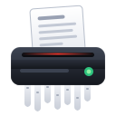
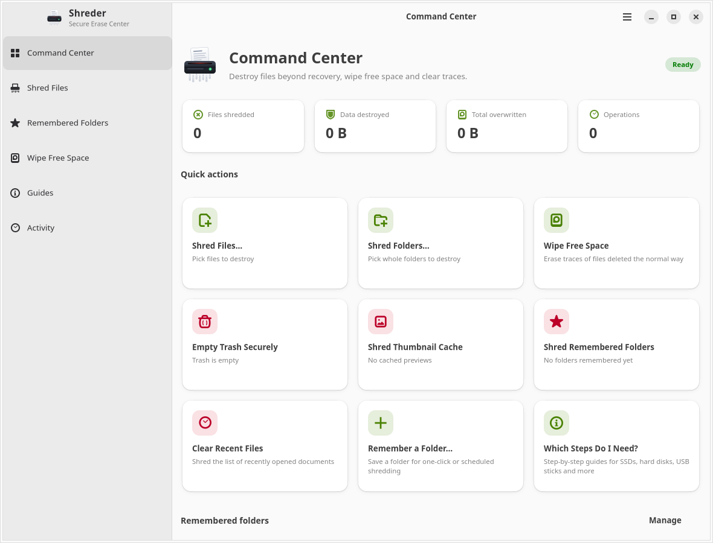
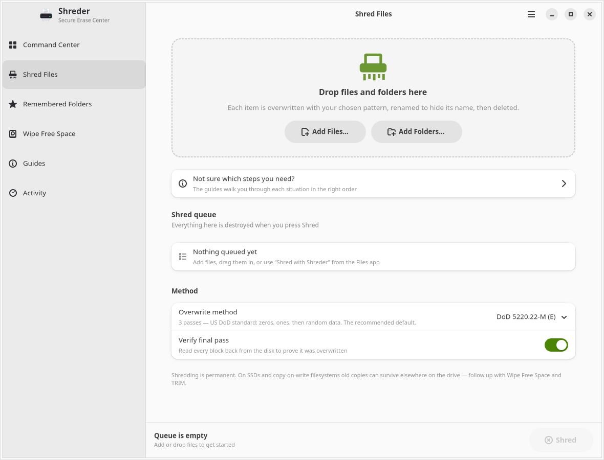
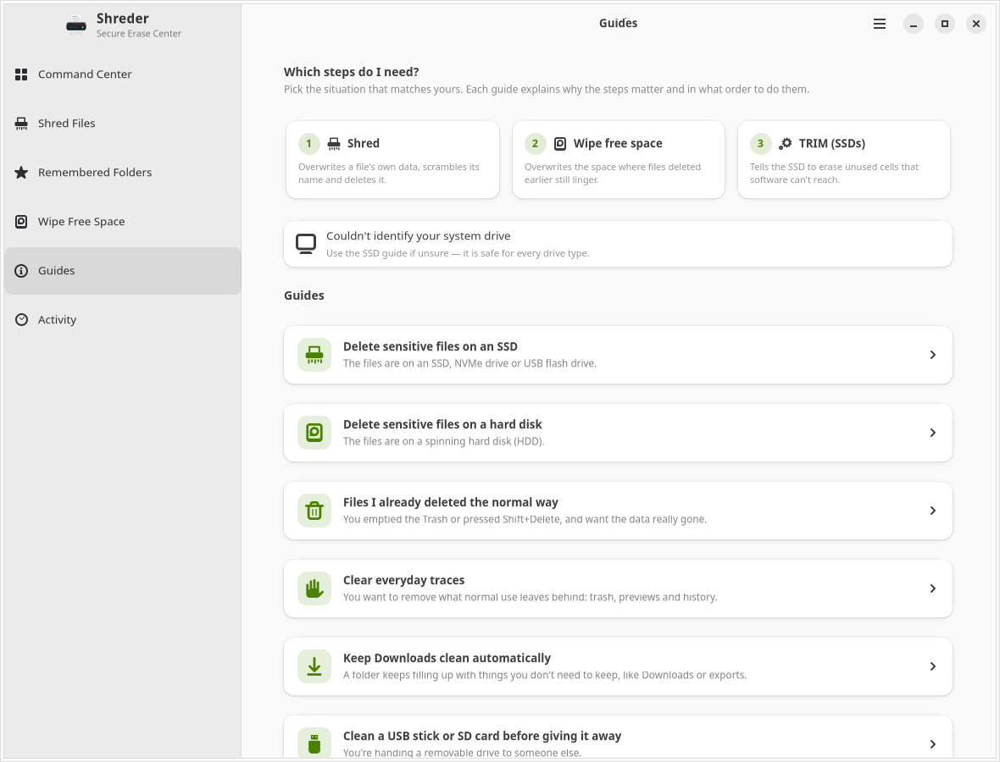
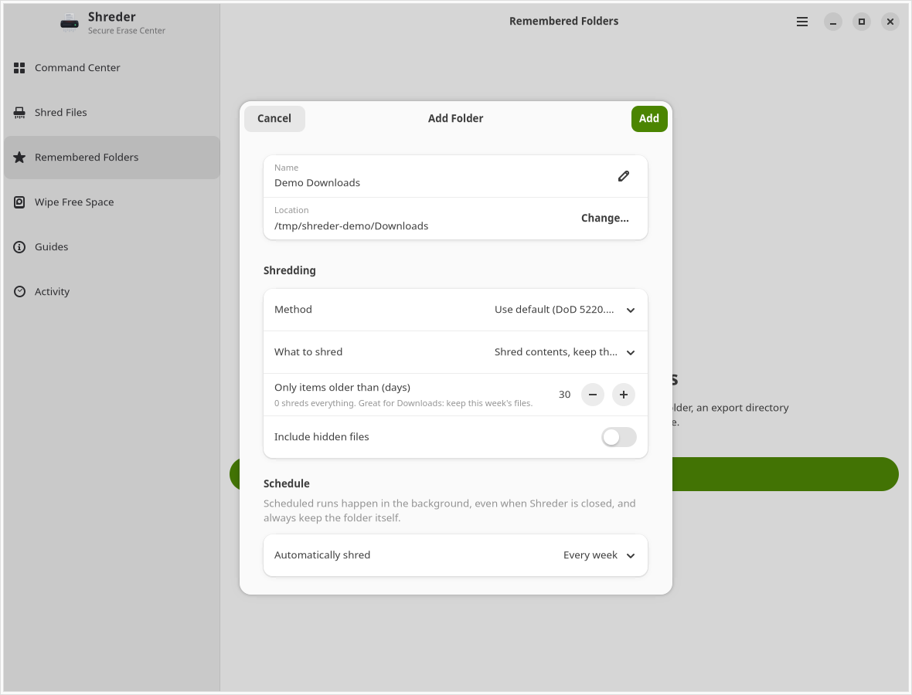

<div align="center">
  
  <h1>Shreder</h1>
  <p>A Linux desktop app for file overwriting, free-space wiping, and routine privacy cleanup.</p>
  <p>Python · GTK 4 · libadwaita · Desktop and command line</p>
</div>

Shreder brings file shredding, saved-folder schedules, drive information, and cleanup tools into one GNOME-style interface. Queue files and folders, choose an overwrite method, and follow progress with speed and time estimates—or use the CLI for terminal workflows.

**Deletion is destructive.** Start with disposable test files. Overwriting cannot guarantee removal of every physical copy on SSDs, flash storage, or copy-on-write filesystems. Read [Storage limitations](#storage-limitations) before using Shreder for sensitive data.

**Explore:** [Screenshots](#screenshots) · [Features](#what-it-does) · [Install](#install-from-source) · [Desktop workflows](#desktop-workflows) · [CLI](#command-line) · [Privacy](#privacy-and-local-data) · [Troubleshooting](#troubleshooting) · [Development](#development-and-contributions)

## Screenshots

Captured from the app in a clean, isolated session with no personal files or history. Host drive information was excluded from the capture session.

**Command Center** — quick actions, cleanup tools, and operation statistics.



**Shred Files** — drag-and-drop targets, overwrite methods, and final-pass verification.



**Guides** — workflows for different storage types and cleanup tasks.



## What it does

- **Shred files and folders:** drag and drop targets, overwrite file contents, optionally verify the final pass, scramble filenames, and remove them.
- **Wipe free space:** write temporary fill files to consume available filesystem space, then remove them. Optional administrator mode can access reserved space.
- **Remember folders:** save frequently cleaned locations with age filters, hidden-file settings, and daily or weekly schedules.
- **Clean everyday traces:** empty Trash locations, remove thumbnail caches, and clear the desktop's recent-files list.
- **Inspect drives:** see filesystem types, space usage, and SSD or copy-on-write warnings. Request TRIM for supported drives.
- **Follow guided workflows:** step through cleanup scenarios for files, deleted data, removable media, and drive disposal.
- **Track work:** view queued jobs, progress, statistics, and local operation history. Cancel running jobs; cancellation does not restore data already overwritten.

## Requirements

The desktop app requires:

- Linux and Python **3.10 or newer**.
- GTK **4** and libadwaita **1.7 or newer**, with Python GObject bindings.
- A graphical desktop session; the interface is designed for GNOME.

Optional integrations use systemd user services for scheduling, Nautilus for the Files right-click action, and `pkexec`/`fstrim` for privileged operations. Drive detection uses `lsblk`. The guide can launch GNOME Disks if installed.

The CLI and engine tests use Python's standard library and do not require GTK.

## Install from source

On Debian/Ubuntu-based distributions whose repositories provide libadwaita 1.7 or newer:

```sh
sudo apt install git python3 python3-gi gir1.2-gtk-4.0 gir1.2-adw-1
```

Older distribution releases may not provide a recent enough libadwaita. The installer checks the installed version.

Clone into a location you intend to keep:

```sh
git clone https://github.com/VincentAZ/shreder.git
cd shreder
./install.sh
```

Open **Shreder** from your application menu, or run:

```sh
~/.local/bin/shreder
```

The installer creates per-user launchers in `~/.local/bin`, a desktop entry, an icon, and a Nautilus script. It does not copy the application into a separate installation directory: **keep the checkout in place**. If you move it, rerun the installer. Add `~/.local/bin` to your `PATH` to use `shreder` and `shreder-cli` by name.

Run `./install.sh` as your normal user; only the dependency-install command above needs `sudo`. The launchers use `/usr/bin/python3`, so GTK bindings must be available to that interpreter.

To omit the Files right-click integration:

```sh
./install.sh --no-files-action
```

For CLI-only use, skip the desktop installer:

```sh
./bin/shreder-cli --help
```

## First use

1. Open **Shred Files** and add disposable files or a test folder.
2. Review the selected targets, overwrite method, and storage warnings.
3. Confirm the operation and follow the job's progress.
4. Check **Activity** for failures, skipped files, or hard-link warnings.

Use **Remembered Folders** for repeat cleanup. Daily and weekly schedules are checked hourly by a systemd user timer; execution depends on the user service manager running. The app does not need to remain open.

Free-space wiping deliberately fills the target filesystem and can disrupt other applications that need to write there. Run it when other disk activity can wait. Normal completion and cancellation attempt to remove fill files; recorded interrupted jobs are checked for cleanup on app startup or scheduled runs.

## Desktop workflows

### Files and folders

Add targets through **Shred Files**, drag and drop them onto the page, or select them in Nautilus and choose **Scripts → Shred with Shreder**. Select an overwrite method and whether to verify the final pass, then review the confirmation. The job queue lets you submit work while another operation runs.

### Remembered folders and schedules

Choose **Remembered Folders → Add Folder…** to configure a location:

- Set a display name and use the default overwrite method or choose one for that folder.
- Choose whether to keep the folder and shred its contents, or remove the folder itself.
- Filter by modification age: `30` means items last modified more than 30 days ago; `0` disables the age filter.
- Include or skip hidden entries within the folder.
- Select manual cleanup, daily, or weekly execution. Scheduling is available only when keeping the folder itself.

The example below uses a demo path, a 30-day age filter, and a weekly schedule. It was captured without saving or running the schedule.



The timer checks hourly, with an additional check shortly after the timer starts. Daily and weekly intervals are based on the folder's last recorded run, not a chosen time of day. A newly scheduled folder with no previous run is due at the next check. Missing folders are skipped. **Forget Folder** removes the saved configuration without deleting the folder or its contents.

### Free space and TRIM

Open **Wipe Free Space**, choose a detected drive and overwrite method, and review the storage warnings. Enable **Run with administrator rights** only when needed for reserved space or an otherwise unwritable location; authorization uses `pkexec`. **Run TRIM** is a separate action for supported drives and also requests administrator authorization.

The directory supplied to a CLI free-space wipe selects the entire filesystem containing it; it does not limit the wipe to that directory. Free-space wiping does not intentionally overwrite existing files, but filling the filesystem can cause other applications' writes to fail.

### Activity and preferences

Open **Activity** to inspect queued jobs and recent results. Expand entries with problems to see recorded errors and warnings. Shared hard-link data may have been deliberately preserved even when the selected names were removed.

The main menu's **Preferences** controls the default method, final-pass verification, filename-renaming passes, notifications, and Files integration. It also shows scheduler status and offers separate actions to clear history and reset statistics. Clearing one does not clear the other.

### Keyboard shortcuts

| Shortcut | Action |
| --- | --- |
| `Ctrl+O` | Add files |
| `Ctrl+Shift+O` | Add folders |
| `Ctrl+1` through `Ctrl+6` | Switch pages in sidebar order |
| `Ctrl+,` | Open Preferences |
| `Ctrl+?` | Show keyboard shortcuts |
| `Ctrl+Q` | Quit |

## Command line

These examples use the installed launcher. From a checkout, substitute `./bin/shreder-cli`.

```sh
# Show available commands and overwrite methods.
shreder-cli --help
shreder-cli methods

# Overwrite a file and verify the final pass; asks for confirmation.
shreder-cli shred ~/test-file.txt --method random --verify

# Remove files older than 30 days while keeping the selected folder.
shreder-cli shred ~/test-cleanup --keep-root --older-than 30

# Fill available space on the filesystem containing this directory.
shreder-cli wipe-free ~/ --method random

# List saved folders, or execute scheduled folders that are due.
shreder-cli folders
shreder-cli run-scheduled
```

### Options

| Option | Commands | Behavior |
| --- | --- | --- |
| `-m`, `--method ID` | `shred`, `wipe-free` | Choose an overwrite method; default: `dod3` |
| `--verify` | `shred` | Read back the final overwrite pass |
| `--keep-root` | `shred` | Keep each selected folder itself; process its contents |
| `--older-than DAYS` | `shred` | Filter by modification age; default: no age filter |
| `--skip-hidden` | `shred` | Skip hidden entries while walking folders |
| `--rename-passes N` | `shred` | Number of filename-scrambling renames; default: `3` |
| `--shred-shared` | `shred` | Overwrite data even when hard links exist outside the selection |
| `-y`, `--yes` | `shred`, `wipe-free` | Skip the confirmation prompt |
| `--json` | `shred`, `wipe-free` | Emit newline-delimited JSON and skip confirmation |

**Both `--yes` and `--json` bypass confirmation.** Check targets before using either in scripts. There is no dry-run option. JSON output includes progress, log, completion, cancellation, or error events as applicable; paths and filenames may appear in that output.

The GUI enables verification by default. CLI shredding requires `--verify` to enable it.

Use `shreder-cli shred --help` or `shreder-cli wipe-free --help` for command-specific help. Press `Ctrl+C` to request cancellation during an operation. Direct CLI `shred` and `wipe-free` commands do not add entries to the app's Activity history; GUI and scheduled jobs do.

For automation, inspect results as well as exit codes: `shred` returns `1` for recorded errors or a declined confirmation, `2` for refused targets, and `130` for cancellation. Warnings about preserved shared data can accompany exit code `0`. The scheduled runner can return `0` even when an individual job failed; review its output and Activity history.

## Overwrite methods

| CLI ID | Method | Passes | Pattern |
| --- | --- | --- | --- |
| `zero` | Zero Fill | 1 | Zeros |
| `random` | Random Data | 1 | Cryptographically random data |
| `dod3` | DoD 5220.22-M (E), default | 3 | Zeros, ones, random |
| `dod7` | DoD 5220.22-M (ECE) | 7 | Three-pass sequence, random, three-pass sequence |
| `schneier` | Bruce Schneier | 7 | Ones, zeros, then five random passes |
| `gutmann` | Peter Gutmann | 35 | Random passes and legacy encoding patterns |

These are overwrite pattern names, not a claim of certification or verified compliance with a sanitization standard. More passes do not resolve storage-layer limitations. Final-pass verification checks the data the operating system reads back, not every physical copy a device may retain.

## Safeguards and storage limitations

### Target safeguards

Shreder refuses protected system paths, the home directory itself, and its own settings locations. Mounted filesystem roots cannot be removed as folders. Symlinks are removed without following their targets; device files, sockets, and pipes are skipped. Recursive shredding does not cross into another mounted filesystem.

**Hard links require special care.** Multiple filenames can refer to the same data. If links exist outside your selection, Shreder defaults to removing the selected names without overwriting the shared contents, and reports a warning. The CLI's `--shred-shared` override can destroy data referenced outside your selection.

These safeguards do not replace checking your targets and backups.

### Storage limitations

Shreder operates through the filesystem. It cannot promise that all previous versions or physical copies are gone:

- **SSDs, NVMe, and USB flash:** controller remapping, wear-leveling, and spare blocks can leave copies outside the operating system's reach. Free-space wiping and TRIM are not proof of complete sanitization.
- **Copy-on-write filesystems and snapshots:** overwrites can allocate new blocks while old versions remain in snapshots or other retained storage.
- **Backups, synced copies, and filesystem metadata:** deleting a target does not remove independent copies, cloud history, or every trace of its name.

Shreder is a file and free-space cleanup tool. It does not implement a whole-device secure-erase workflow. For drive disposal or formal sanitization requirements, use a process appropriate to the specific device and required assurance level.

## Privacy and local data

Shreder has no application telemetry, account requirement, or built-in data-upload code. It does retain information locally:

- **Settings:** `~/.config/shreder/config.json` stores preferences, saved-folder paths and labels, schedules, statistics, and pending cleanup paths.
- **Activity:** `~/.local/share/shreder/history.jsonl` stores operation timestamps, titles, target paths, results, and errors or warnings that may contain filenames. History is periodically trimmed to 500 entries after exceeding 600.
- **Desktop notifications:** enabled by default; job titles and errors can reveal filenames or folder labels.
- **Scheduled output:** folder labels and results are printed by the scheduled runner and may be retained by the systemd journal.

`XDG_CONFIG_HOME` and `XDG_DATA_HOME` override the default settings and data locations. Settings and history are plaintext; creation permissions follow the process's umask. **Shredding a file does not erase its name from Shreder's own history.**

Disable notifications or clear activity history in **Preferences**. Clearing history removes the history file; it does not securely overwrite it or clear notifications, system logs, or backups.

## Update or uninstall

To update, close Shreder, wait for running jobs to finish, then run from the checkout:

```sh
git pull --ff-only
./install.sh
```

To remove launchers and desktop/scheduler integration:

```sh
./uninstall.sh
```

Settings and history are kept by default. To remove them too:

```sh
./uninstall.sh --purge
```

Uninstalling does not delete the source checkout. Purging removes local data files using ordinary deletion, not secure overwriting.

## Troubleshooting

**The installer reports missing GTK or an old libadwaita.** Install the distribution packages listed above and verify that libadwaita is at least 1.7. A Python virtual environment or a newer Python alone does not upgrade the system GTK libraries. Check the interpreter used by the launchers:

```sh
/usr/bin/python3 -c 'import gi; gi.require_version("Gtk", "4.0"); gi.require_version("Adw", "1"); from gi.repository import Adw; print(Adw.get_major_version(), Adw.get_minor_version())'
```

**`shreder` is not found, or a launcher stopped working.** Try `~/.local/bin/shreder` directly. Ensure `~/.local/bin` is on your `PATH`. If the checkout moved, rerun `./install.sh` from its new location. If you use scheduled folders, resave a scheduled folder's settings to regenerate the timer's application path.

**The Files action is missing.** The integration is a Nautilus script under the **Scripts** submenu, not a general extension for every file manager. Enable it in Preferences or rerun the installer without `--no-files-action`, then reopen Files. The app currently writes this script under `~/.local/share/nautilus/scripts` even when `XDG_DATA_HOME` is customized; uninstall uses `XDG_DATA_HOME`, so a custom setup may require removing that script separately.

**A scheduled folder did not run.** Confirm that the location exists, its schedule is enabled, and the systemd user manager is running. New schedules are checked by the timer, rather than immediately when saved. Inspect the timer and recent runner output:

```sh
systemctl --user status shreder-scheduler.timer
systemctl --user list-timers shreder-scheduler.timer
journalctl --user -u shreder-scheduler.service -n 50 --no-pager
```

These commands inspect status; `shreder-cli run-scheduled` actually executes due jobs. Journal output can contain folder names—redact it before sharing.

**A drive is missing or TRIM fails.** Use **Rescan drives**, confirm the filesystem is mounted, and check that `lsblk` is available. Shreder filters out unsupported and system-only mounts. TRIM depends on filesystem/device support and successful `pkexec` authorization; inspect the reported error in Activity.

**A file was skipped or its shared data was kept.** Check Activity's expanded warnings. Protected locations, mounted subtrees, special files, permissions, age filters, and hard links can affect what is processed. Removing a hard-linked filename does not mean the shared contents were overwritten.

## Development and contributions

The application runs directly from source; there is no compilation step.

```sh
# Run the engine tests using temporary test files and isolated app settings.
python3 -m unittest discover -s tests -v

# Launch the desktop app from the checkout.
./bin/shreder
```

The core overwrite logic is in `shreder/engine.py`, system integration in `shreder/system.py`, persistence in `shreder/store.py`, and the GTK interface in `shreder/ui/`.

Bug reports and focused pull requests are welcome. For bugs, include your distribution, Python/GTK/libadwaita versions, filesystem and drive type, and reproduction steps using disposable files. Redact personal paths and filenames from logs and screenshots before posting them in [GitHub issues](https://github.com/VincentAZ/shreder/issues).

## License

Shreder is licensed under the [MIT License](LICENSE).
